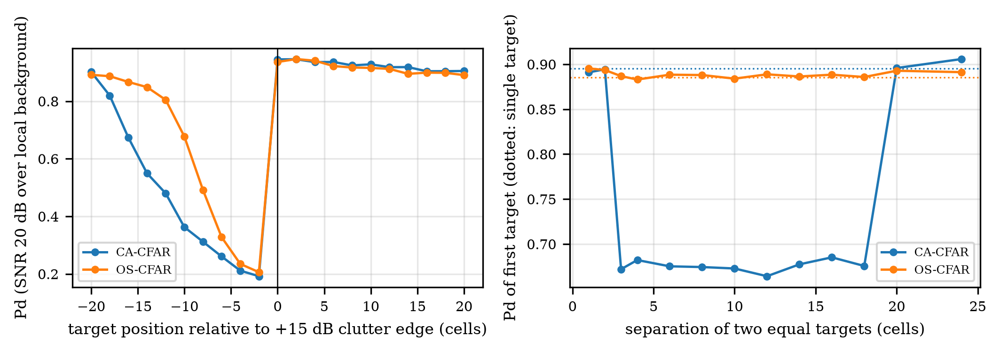

# FMCW radar drone detection with a verified CFAR hardware block

Simulation study. A 24 GHz FMCW radar processing chain for small drones (range and Doppler
FFTs, clutter suppression, CA/OS/2D CFAR), detection performance checked against closed-form
theory, a streaming 1D CA-CFAR in Verilog verified **bit-exactly** against a Python
fixed-point model, FPGA resource estimates, and a micro-Doppler drone-vs-bird classifier
evaluated with leakage-safe splits.

**Results: [RESULTS.md](RESULTS.md).** Hardware block: [rtl/README.md](rtl/README.md).
Decisions: [docs/DECISIONS.md](docs/DECISIONS.md). Study guide: [docs/EXPLAINER.md](docs/EXPLAINER.md).



## What is in here

| Path | Content |
|---|---|
| `src/radar/` | FMCW parameters, beat-signal simulator, ground clutter, drone (rotors) and bird (flapping) scatterer models |
| `src/proc/` | windows, range/Doppler FFT, MTI/mean clutter suppression, CA/OS/2D CFAR, clustering, detection theory |
| `src/hw_model/` | bit-exact fixed-point model of the RTL |
| `rtl/` | `cfar_ca_1d.v`, interface/latency/overflow notes, Vivado instructions |
| `tb/` | xsim testbench + Python runner, mutation test, waveform rendering |
| `synth/` | Yosys (`synth_xilinx`) and Vivado (out-of-context P&R) scripts and reports |
| `src/classify/` | micro-Doppler dataset with instance IDs, splits, TinyCNN, features, simulated INT8 |
| `scripts/` | experiments; `write_results.py` generates RESULTS.md |

## Reproduce

```bash
python -m venv .venv && .venv/Scripts/pip install -r requirements-lock.txt
make test          # pytest
make figures       # RESULTS.md from committed results
make all           # everything (needs Vivado 2025.2 for RTL simulation; VIVADO_BIN env var)
```
Without `make`: `python reproduce.py test figures`. Yosys comes from PyPI (`yowasp-yosys`).

## Tools

Python 3.14, NumPy/SciPy/PyTorch/scikit-learn; Vivado 2025.2 xsim for RTL simulation and
out-of-context implementation; Yosys 0.70 (yowasp) for open-source synthesis estimates.
The spec suggested cocotb + Verilator; they could not be installed on this Windows machine
without a system-wide MSYS2 upgrade (docs/DECISIONS.md #1). The verification standard is
unchanged: bit-exact RTL vs model on every test.

## Limitations

Simulated data only (point scatterers). RTL verified in simulation only; resources and
Fmax are tool reports, not board measurements. No tracking or antenna model.
